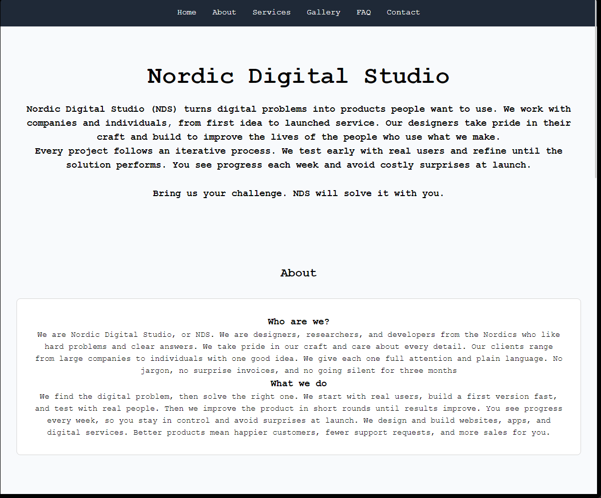
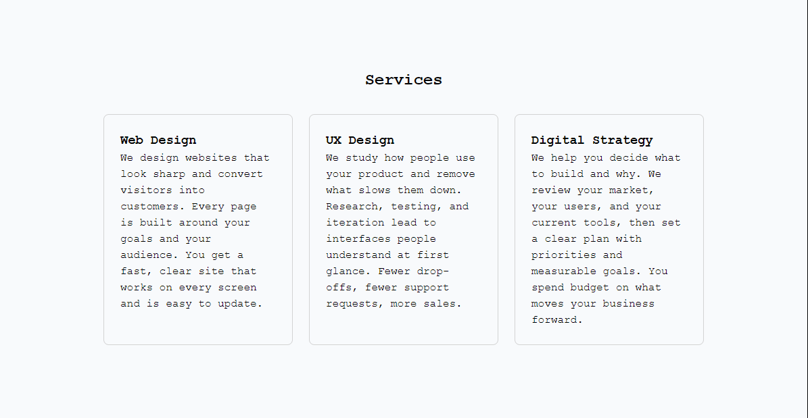
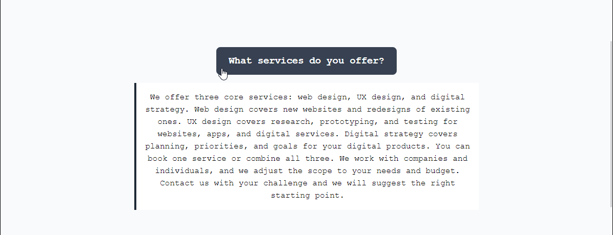
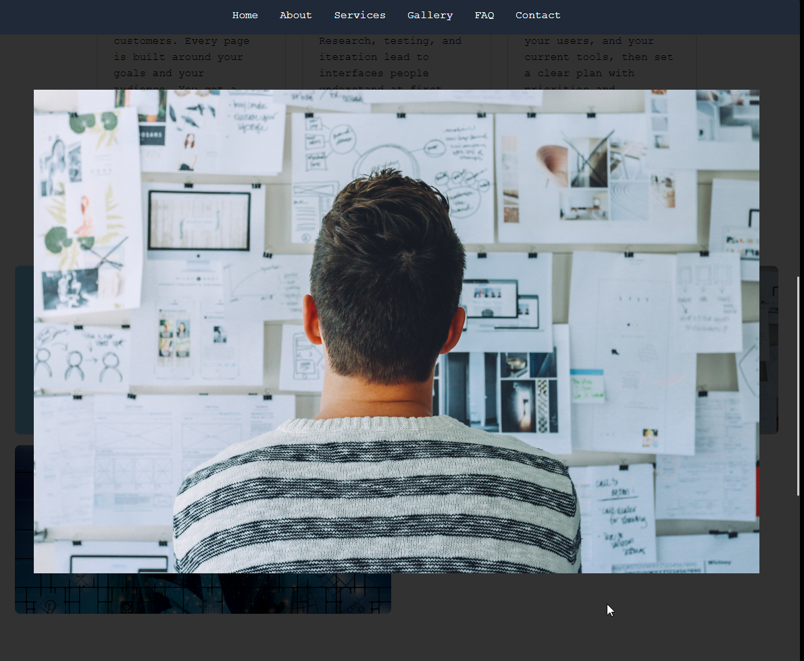

# Nordic Digital Studio

- Business Project Website

## Project Description

Nordic Digital Studio is a responsive business website developed as part of a frontend development course project.

The website represents a fictional digital agency that offers Web Design, UX Design, and Digital Strategy services. The purpose of the project was to demonstrate the use of semantic HTML5, CSS3, responsive design, and basic JavaScript functionality in a realistic business website scenario.

---

## Features

- Responsive layout for desktop and mobile devices
- Sticky navigation menu
- Hero section
- About section
- Services section
- Gallery section
- FAQ accordion built with JavaScript
- Image lightbox functionality
- Contact section
- Footer section
- Smooth scrolling navigation

---

## Technologies

- HTML5
- CSS3
- JavaScript
- CSS Flexbox
- CSS Grid

---

## Installation

1. Clone or download the repository.
2. Open the project folder on your computer.
3. Ensure the images folder is included.
4. Open `index.html` in your preferred web browser.

---

## How to Run

### Run Locally

1. Download the project files.
2. Open the project folder.
3. Double-click `index.html` or open it in a browser.
4. Explore the website using the navigation menu.

### Online Version

The project can also be viewed through GitHub Pages.

---

## Screenshots

### Home Page

### Services Section

### FAQ and Lightbox Features

---

## Team Members

### Johan Lorentz

Role:

- Designer
- Developer
- Content Creator

GitHub:
https://github.com/lorriluring

---

## AI Usage

This project was created for educational purposes as part of a frontend development course.

Nordic Digital Studio is a fictional company created specifically for this assignment. Some text content, including business descriptions, service descriptions, FAQ content, and other placeholder copy, was generated with the assistance of AI and then reviewed and adapted for the project.

The primary focus of this assignment was frontend development using HTML, CSS, responsive design principles, and JavaScript functionality rather than commercial content production.

---

## Future Improvements

Possible future improvements include:

- Additional FAQ items
- Contact form validation
- Dark mode support
- Expanded image gallery
- Additional service offerings
- More advanced animations and transitions
- Backend integration for contact requests
